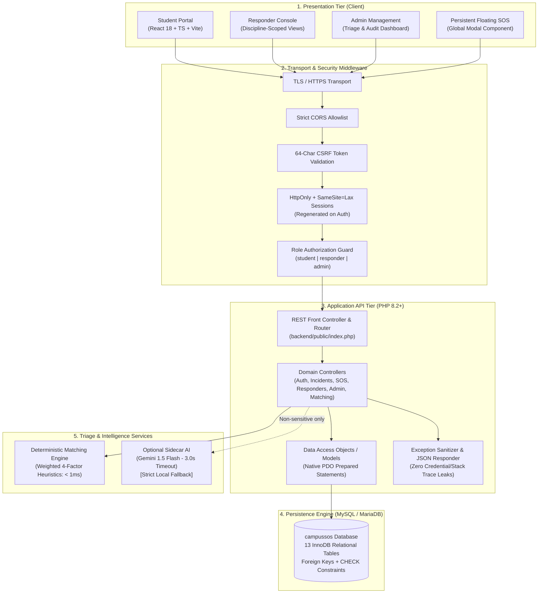
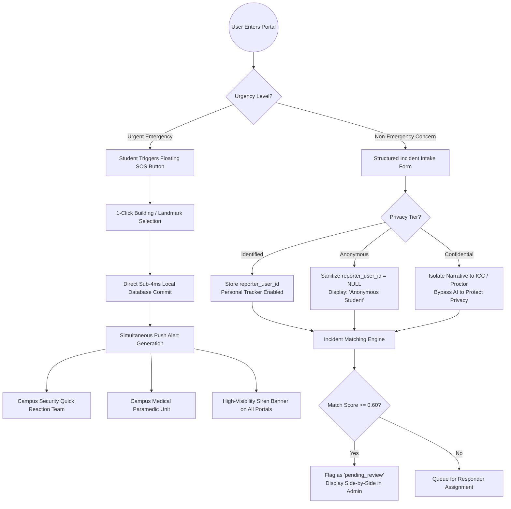
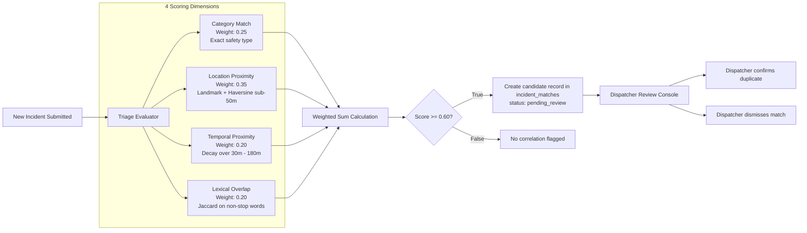
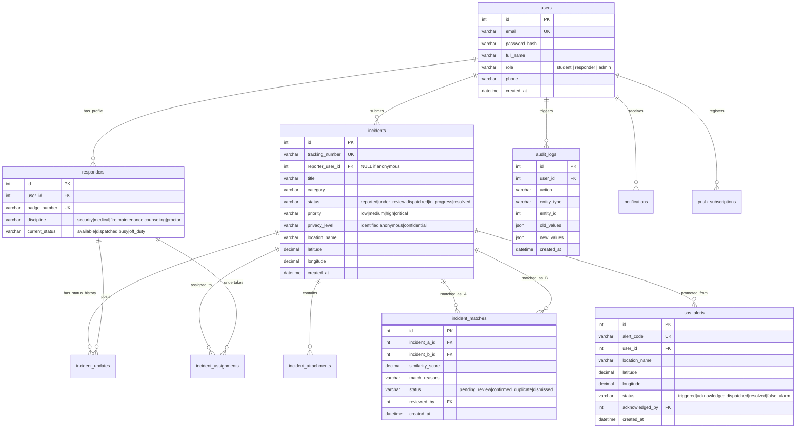
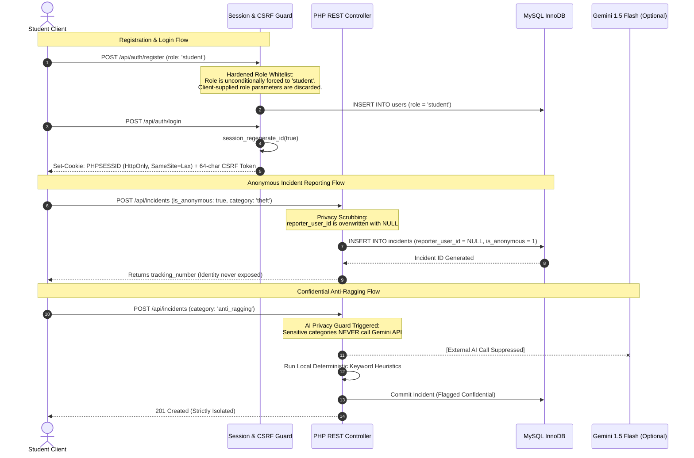

# CampusSOS — Architecture & System Design Diagrams

> **Student Project Expo 2026 // Technical Architecture Guide**  
> Comprehensive visual diagrams for judges, presentation defense, and system documentation.

---

## 1. High-Level System Architecture

CampusSOS follows a tiered, modular, and privacy-first architectural model. Presentation, application logic, persistence, and triage services are decoupled.

---

## 2. Dual-Pathway Workflow Architecture

CampusSOS strictly isolates **Emergency Life-Safety Dispatch** from **Routine Concern Governance**.

---

## 3. Deterministic Incident Matching Engine

The multi-factor incident deduplication algorithm provides transparent, auditable scoring without black-box machine learning dependencies.

### Mathematical Formulation
$$\text{Total Score} = 0.25 \cdot S_{\text{category}} + 0.35 \cdot S_{\text{location}} + 0.20 \cdot S_{\text{time}} + 0.20 \cdot S_{\text{lexical}}$$

---

## 4. Entity-Relationship Diagram (13 Relational Tables)

All tables use MySQL/MariaDB InnoDB with foreign key constraints, compound indexes, and database-level check constraints.

---

## 5. Security & Privacy Enforcement Architecture

---

## 6. Architecture Highlights for Technical Defense

| Dimension | Architectural Implementation | Benefit / Protection |
|---|---|---|
| **SQL Injection** | Native PDO Prepared Statements (`ATTR_EMULATE_PREPARES => false`) | Total immunity from SQL parameter tampering |
| **Privilege Escalation** | Rigid role enum checks in controller middleware | Students cannot access responder queues or admin tables |
| **Session Hijacking** | `HttpOnly`, `SameSite=Lax`, `session_regenerate_id(true)` | Protects session tokens from XSS theft and fixation |
| **Data Leakage** | Anonymous reports set `reporter_user_id = NULL` at database level | Impossible for staff to retrieve student ID via queries |
| **Denial of Service (AI)** | 3.0s cURL timeout with sub-2ms deterministic fallback | Emergency triage never stalls due to cloud network drops |
| **Duplicate Collisions** | MySQL check constraint `CHECK (incident_a_id < incident_b_id)` | Prevents duplicate cycles ($A \leftrightarrow B$) and self-matching |

